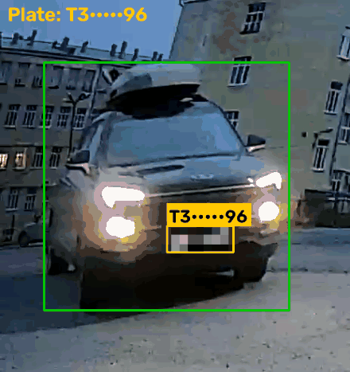
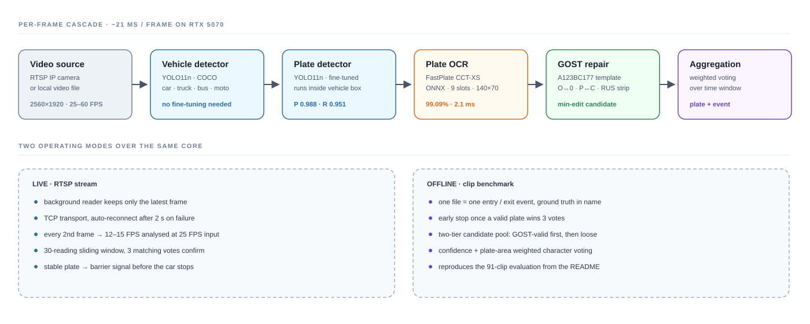
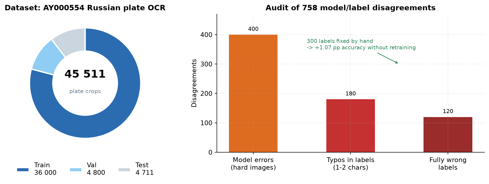
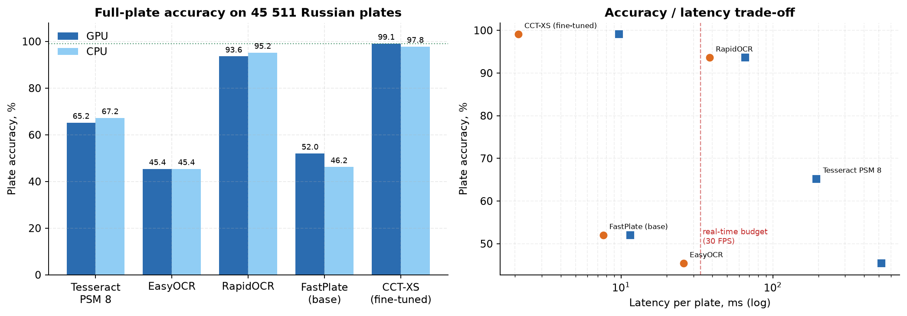
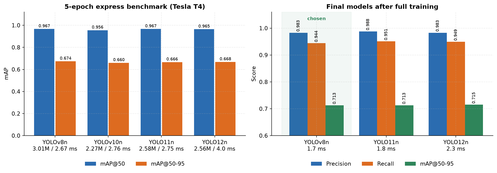
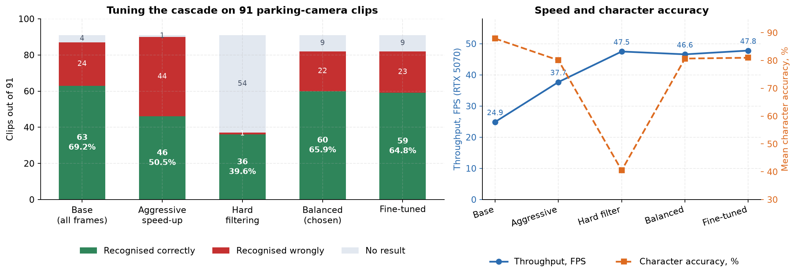
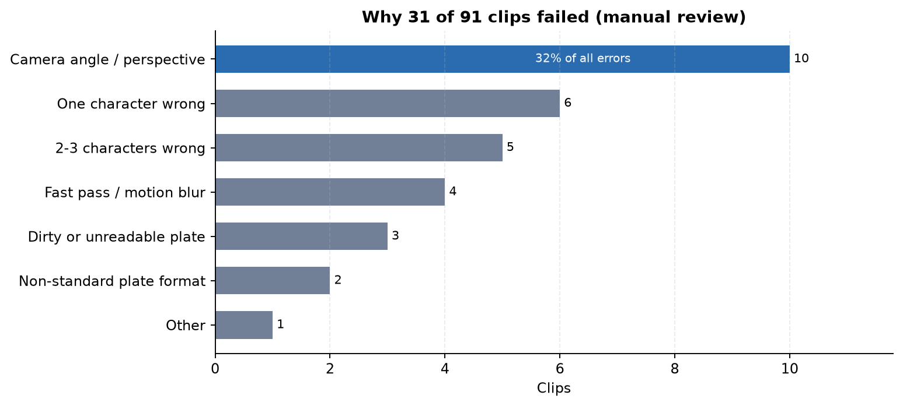
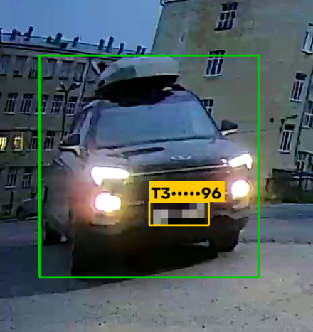
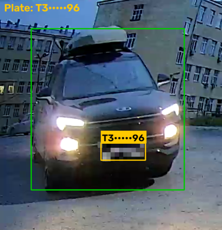

# Распознавание автомобильных номеров в реальном времени


Система автоматического распознавания российских регистрационных знаков (ALPR/ANPR),
работающая в реальном времени на видеопотоке с IP-камеры. Каскад из двух YOLO11n-детекторов
и дообученной OCR-модели, постобработка по ГОСТ Р 50577 и временная агрегация результатов.
Пилотное внедрение — камера шлагбаума на парковке института.

<p align="center">
  
</p>

<p align="center">
  <sub>Реальный кадр с пилотной камеры. Зелёный — автомобиль, жёлтый — номер,
  заголовок — номер, подтверждённый голосованием по нескольким кадрам.
  Номерные знаки на кадрах пикселизированы, в подписях скрыты средние символы.</sub>
</p>

## Коротко о результате

| Что измеряли | Результат |
|---|---|
| OCR на 45 511 эталонных вырезках номеров | **99.09%** полностью верных номеров, **99.89%** символов, **2.1 мс** на номер (GPU) |
| Детектор номерных знаков | **P = 0.988**, **R = 0.951**, mAP@50 = 0.975, **1.8 мс** на кадр |
| Сквозной пайплайн на 91 реальном видеоклипе | **65.9%** верных номеров, **80.7%** символов, **46.6 FPS** (RTX 5070) |
| Внедрение | RTSP-поток со шлагбаума, устойчивое распознавание при подъезде автомобиля |

> **Честная оговорка.** 99.09% относятся к изолированному OCR-модулю на выровненных
> вырезках. В полном каскаде на реальном видео точность падает до 65.9% — и главная
> причина этого падения не модель, а острый угол съёмки. Разбору этого разрыва
> посвящён [отдельный раздел](#почему-99-превращается-в-66--главный-инженерный-вывод).

## Содержание

- [Проблема](#проблема)
- [Моя роль](#моя-роль)
- [Архитектура](#архитектура)
- [Данные](#данные)
- [Эксперименты](#эксперименты)
- [Почему 99% превращается в 66%](#почему-99-превращается-в-66--главный-инженерный-вывод)
- [Демо](#демо)
- [Результат внедрения](#результат-внедрения)
- [Стек](#стек)
- [Структура репозитория](#структура-репозитория)
- [Быстрый старт](#быстрый-старт)
- [Ограничения и планы](#ограничения-и-планы)
- [Лицензия](#лицензия)

---

## Проблема

Парковка с шлагбаумом — типичный сценарий, где ручной контроль доступа перестаёт
масштабироваться: охранник не успевает проверять номера, а водители стоят в очереди
на въезде. Готовые коммерческие ALPR-платформы решают задачу, но стоят от 15 000 ₽
за канал, закрыты для дообучения и плохо переносятся на нестандартный ракурс конкретной
камеры. Открытые проекты либо устарели (OpenALPR на Tesseract — 42% точности), либо
реализуют только половину пайплайна: детектор без OCR или OCR без работы с видео.

Нужна была открытая система, которая:

1. распознаёт **российские** номера (кириллица, ГОСТ Р 50577, региональный код 2–3 цифры);
2. работает **в реальном времени** с IP-камеры по RTSP, а не только с файлов;
3. даёт **устойчивый** ответ, а не мигающие строки на каждом кадре;
4. допускает дообучение под конкретную камеру и ракурс.

Дополнительная сложность — не сам OCR, а условия съёмки. Камера на шлагбауме смотрит
перпендикулярно движению: номер виден под острым углом, в перспективе, часто в движении
и при неконтролируемом освещении. Лабораторные бенчмарки такие условия не воспроизводят.

## Моя роль

Проект выполнен мной единолично — от анализа предметной области до запуска на объекте.
Конкретно я сделал:

- **Обзор и выбор архитектуры.** Сравнил коммерческие (SecurOS Auto, Genetec AutoVu,
  Rekor Scout) и открытые решения, обосновал модульный каскад вместо end-to-end модели:
  компоненты можно менять и дообучать независимо.
- **Бенчмарк OCR-движков.** Собрал единый протокол оценки (полный номер / символы /
  латентность) и прогнал Tesseract, EasyOCR, RapidOCR, FastPlate на 45 511 российских
  номерах — вручную и на синтетике.
- **Дообучение OCR.** Взял FastPlate CCT-XS (Compact Convolutional Transformer),
  настроил 9-слотовую схему классификации, обучил на GPU, экспортировал в ONNX.
- **Аудит разметки.** Классифицировал 758 расхождений модели с эталоном, нашёл ~300
  ошибочных меток в открытом датасете, исправил их и получил +1.07 п.п. точности
  без переобучения.
- **Сравнение и обучение детекторов.** Прогнал YOLOv8n / v10n / v11n / v12n на одном
  датасете, выбрал YOLO11n по совокупности P/R/латентности.
- **Сборка пайплайна.** Каскад «автомобиль → номер → OCR», нормализация и починка строки
  под ГОСТ, агрегация по кадрам.
- **Тестирование на реальных данных.** Собрал 91 клип из записей камеры (12.5 ГБ исходников),
  провёл серию из пяти конфигураций пайплайна, разметил все 31 ошибку вручную.
- **Адаптация к RTSP и внедрение.** Фоновый ридер с «последним кадром», TCP-транспорт,
  автопереподключение, скользящее окно голосования; запуск на стенде со шлагбаумом.

## Архитектура

<p align="center">
  
</p>

Пайплайн сознательно сделан **каскадным**, а не end-to-end:

| Модуль | Модель | Почему так |
|---|---|---|
| Детекция автомобиля | YOLO11n, предобученная на COCO | Классы car/truck/bus/moto уже хорошо представлены; дообучение не требуется |
| Детекция номера | YOLO11n, дообученная на Kaggle License Plate Recognition | Работает **внутри** рамки автомобиля: номер занимает доли процента кадра 2560×1920, и при подаче всего кадра на вход сети символы физически не различимы |
| OCR | FastPlate CCT-XS, ONNX, 140×70, grayscale | 2.1 мс против 38 мс у RapidOCR при точности 99.09% |
| Постобработка | Чистый Python + regex | Приводит «сырую» строку к `A123BC177`, убирает блок RUS, исправляет O↔0, P↔C |
| Агрегация | Взвешенное голосование | Один кадр — шумное наблюдение; решение принимается по нескольким |

Ключевые архитектурные решения:

**1. Два детектора вместо одного.** Прямая детекция номера на полном кадре теряет
символы при downscale, а внутри кропа автомобиля номер остаётся крупным. Побочный
эффект — второй детектор никогда не видит дорожные знаки и вывески, поэтому ложных
срабатываний почти нет.

**2. Фиксированные слоты вместо CTC.** CCT-XS предсказывает 9 независимых позиций.
Классическое жадное CTC-декодирование склеивает повторяющиеся символы и ломает номера
вида `A111AA`. Декодирование «argmax по слоту + отбрасывание pad» вернуло точность
на ожидаемый уровень — это была одна из двух ошибок интеграции, найденных при первом
запуске (вторая — лишняя предобработка, не совпадавшая с обучением).

**3. Починка строки вместо отказа.** OCR отдаёт до 9 символов, включая мусор от рамки
и блока «RUS». Вместо жёсткой валидации строка перебирается по всем стартовым позициям,
и выбирается кандидат, потребовавший минимум замен. Это позволяет восстановить номер
даже при одной ошибке распознавания — но именно поэтому финальная валидация отдельно
отмечает, был ли кандидат «строгим» (полностью по ГОСТ) или «мягким».

**4. Два режима агрегации.** Офлайн: голосование по всему клипу с двумя уровнями
надёжности (сначала ГОСТ-валидные, затем любые) и досрочной остановкой. Онлайн: кольцевое
окно из 30 последних чтений, 3 совпадения — номер стабилен; уехавший автомобиль
автоматически «забывается» без явного события выезда.

**5. Потоковый ридер.** Наивный цикл `cap.read()` + инференс дрейфует: пока GPU считает
кадр N, камера пишет следующие, и система обрабатывает прошлое. Фоновый поток хранит
только последний кадр — задержка перестаёт расти. Плюс TCP вместо UDP, автопереподключение
через 2 с и процентное кодирование логина/пароля в RTSP-URL.

## Данные

| Датасет | Объём | Назначение |
|---|---|---|
| [AY000554/Car_plate_OCR_dataset](https://huggingface.co/datasets/AY000554/Car_plate_OCR_dataset) | 45 511 вырезок российских номеров | Дообучение и тестирование OCR |
| [adilshamim8/license-plate-recognition](https://www.kaggle.com/datasets/adilshamim8/license-plate-recognition) | изображения с рамками номеров (1 класс) | Обучение детектора номеров |
| Записи пилотной камеры | ~12.5 ГБ, 2 съёмочных дня | 91 тестовый клип (5–20 с, один въезд/выезд) |

<p align="center">
  
</p>

Подготовка OCR-датасета: разметка извлекалась из имени файла, алфавит ограничен
18 символами (`0-9` + `АВЕКМНОРСТУХ`), дубликаты и битые файлы удалены. Приёмка
модели по полной выборке выявила 758 расхождений с эталоном; ручная классификация
показала, что примерно **300 из них — ошибки самой разметки**, а не модели. После
исправления меток точность выросла с 98.20% до 99.27% **без изменения весов**.

## Эксперименты

### 1. OCR: четыре движка на одном протоколе

<p align="center">
  
</p>

| Движок | Номер, GPU | Символы, GPU | Латентность, GPU | Номер, CPU |
|---|---|---|---|---|
| Tesseract (PSM 8) | 65.2% | 93.2% | 195.2 мс | 67.2% |
| EasyOCR | 45.4% | 85.2% | 25.8 мс | 45.4% |
| RapidOCR (PP-OCRv4) | 93.6% | 97.8% | 38.3 мс | 95.2% |
| FastPlate CCT-XS, без дообучения | 52.0% | 84.3% | 7.6 мс | 46.2% |
| **FastPlate CCT-XS, дообученная** | **99.09%** | **99.89%** | **2.1 мс** | 97.8% |

Tesseract читает символы неплохо, но проваливает номер целиком — а для шлагбаума
важна именно целая строка. RapidOCR точен, но в 18 раз медленнее. Лёгкая
специализированная модель после дообучения выигрывает по обоим критериям сразу.

Параметры обучения: CCT-XS, 36 000 / 4 800 / 4 711 (train/val/test), вход 140×70
grayscale, batch 64, lr 1e-4 с cosine decay, 9 слотов, CCE, mixed precision FP16,
early stopping по `val_plate_acc` (остановка на 52-й эпохе, val 98.13%), экспорт ONNX
opset 17. Обучение — Google Colab T4 и локально RTX 5070 (WSL2, CUDA 12.8).

### 2. Детектор номера: четыре архитектуры YOLO

<p align="center">
  
</p>

| Модель | Параметры | P | R | mAP@50 | mAP@50-95 | Инференс |
|---|---|---|---|---|---|---|
| YOLOv8n | 3.01M | 0.983 | 0.944 | 0.974 | 0.713 | 1.7 мс |
| **YOLO11n** | **2.58M** | **0.988** | **0.951** | **0.975** | **0.713** | **1.8 мс** |
| YOLO12n | 2.56M | 0.983 | 0.949 | 0.975 | 0.715 | 2.3 мс |

Экспресс-прогон по 5 эпох отсеял YOLOv10n (худшие mAP при равной скорости), полное
обучение велось на 640×640, batch 16, AdamW (lr 0.002, momentum 0.9), patience 10.
YOLO12n выигрывает 0.002 по строгой метрике локализации, но теряет 28% скорости — для
каскада это невыгодный обмен, поэтому выбран YOLO11n с лучшими P и R.

### 3. Сквозной пайплайн: пять конфигураций

Система прогонялась на 91 клипе. Каждая конфигурация — компромисс между полнотой
ответа и скоростью:

<p align="center">
  
</p>

| Конфигурация | Верно | Ошибки | Пропуски | Символы | FPS |
|---|---|---|---|---|---|
| Базовая (все кадры) | 63 (69.2%) | 24 | 4 | 87.9% | 24.9 |
| Агрессивное ускорение | 46 (50.5%) | 44 | 1 | 80.1% | 37.7 |
| Жёсткая фильтрация | 36 (39.6%) | 1 | 54 | 40.5% | 47.5 |
| **Сбалансированная (выбрана)** | **60 (65.9%)** | **22** | **9** | **80.7%** | **46.6** |
| Тонкая настройка порогов | 59 (64.8%) | 23 | 9 | 81.0% | 47.8 |

Интересный результат: базовая конфигурация даёт **больше** верных ответов (69.2%), чем
выбранная (65.9%), но в два раза медленнее. Выбор «сбалансированной» — инженерное
решение в пользу реального времени: 46.6 FPS вместо 24.9 при потере 3.3 п.п. Жёсткая
фильтрация показывает обратную крайность — почти без ошибок, но 54 пропуска: система,
которая «боится» отвечать, для шлагбаума бесполезна.

### 4. Разбор 31 ошибки

<p align="center">
  
</p>

Каждый ошибочный клип был просмотрен вручную и отнесён к категории. Самая частая
причина — **острый угол обзора (10 клипов)**; далее идут одиночные ошибки символов
(6), ошибки в 2–3 символах (5), быстрый проезд с размытием (4), грязные номера (3),
нестандартный формат (2) и одна прочая. Путаница P↔C встречалась и в статическом
бенчмарке — это устойчивая особенность модели на российском шрифте.

## Почему 99% превращается в 66% — главный инженерный вывод

Разрыв между 99.09% на вырезках и 65.9% на видео — не дефект OCR-модели, а свойство
каскада и геометрии съёмки:

| Фактор | Статический бенчмарк | Реальное видео |
|---|---|---|
| Ракурс | фронтальный | острый угол, трапецеидальные искажения |
| Вход OCR | выровненные вручную вырезки | автоматические кропы из детектора |
| Качество кропа | идеальное | обрезано, смещено, с рамкой и крепежом |
| Motion blur | нет | есть на движущихся авто |
| Накопление ошибок | только OCR | детекция авто → номер → OCR |

Простая арифметика каскада подтверждает измерения: 0.90 × 0.85 × 0.85 ≈ **0.65**, то есть
наблюдаемые 65.9% — это ровно то, что даёт перемножение точностей каскада. Дальнейшее
ужесточение порогов лишь перекладывает ошибки в пропуски (см. таблицу выше), поэтому
потолок достигается не подбором параметров, а устранением причины — перспективной
коррекцией номера перед OCR и дообучением на кропах из реального видеопотока.

Это же объясняет, почему 65.9% — не «плохой результат»: система честно измерена
на реальных данных в тех условиях, в которых её предполагалось эксплуатировать,
а не на отобранных красивых кадрах.

## Демо

<p align="center">
  
</p>

<p align="center">
  
  &nbsp;&nbsp;
  
</p>

<p align="center">
  <sub>Слева — чтение на одном кадре (может ошибаться), справа — номер, подтверждённый
  агрегацией. Реальный номер на обоих кадрах пикселизирован, в подписи скрыты средние
  символы: пайплайн настоящий, идентификатор автомобиля — нет.</sub>
</p>

Демо собрано на реальном клипе из тестового набора. GIF специально показывает, что
покадровые чтения «плавают», а решение принимается по совокупности — это и есть смысл
модуля агрегации.

**Приватность.** Любые кадры с камеры перед публикацией прогоняются через
`scripts/anonymize_clip.py`: он находит номерные знаки двумя способами — обычным
каскадом и дополнительным сканированием кадра перекрывающимися тайлами (каскад
пропускает далёкие номера, тайловый проход их ловит) — и заменяет их мозаикой.
Машина и сцена остаются видимыми, идентификатор — нет. Скрипт работает без
OCR-модели:

```bash
python scripts/anonymize_clip.py --clip raw.avi --out redacted.mp4 --blocks 12
```

Запуск на своём видео или камере:

```bash
# видеофайл + сохранение размеченного результата
python scripts/process_clip.py --clip data/sample.mp4 --save-video out/demo.mp4

# живая камера (учётные данные берутся из переменных окружения)
set RTSP_HOST=192.168.1.64:554
set RTSP_PATH=/Streaming/Channels/101
set RTSP_USER=viewer
set RTSP_PASS=change-me
python scripts/run_rtsp.py
```

## Результат внедрения

Система была развёрнута на камере шлагбаума парковки института и проверена на реальном
стенде. Что подтвердилось в ходе эксплуатации:

- потоковая версия работает с IP-камеры по RTSP (TCP) без остановок на длительном интервале;
- разрыв соединения или перезагрузка камеры не роняют систему — ридер переподключается
  автоматически, основной цикл продолжает работу;
- при **медленном подъезде** номер распознаётся и управляющий сигнал формируется заранее,
  поэтому шлагбаум успевает открыться **до полной остановки** автомобиля — именно это
  и было конечной целью;
- стабильный номер не «мигает»: он фиксируется после трёх совпадающих чтений и держится,
  пока окно голосования не перезапишется следующим автомобилем.

Ограничения стенда, которые видны на демо: камера смотрит перпендикулярно движению,
поэтому номер почти всегда в перспективе. Это и есть основной резерв роста точности
(65.9% → 90%+ достижимы коррекцией перспективы и дообучением на реальных кропах).

## Стек

| Слой | Технологии |
|---|---|
| Язык | Python 3.12 |
| Детекция | Ultralytics YOLO11n (PyTorch 2.10 + CUDA 12.8) |
| OCR | FastPlate CCT-XS, ONNX Runtime GPU 1.24 |
| Видео | OpenCV (`VideoCapture`, FFmpeg, RTSP/TCP) |
| Данные | NumPy, pandas, PyYAML |
| Визуализация | Matplotlib (графики), OpenCV (оверлеи) |
| Обучение | Google Colab (T4), WSL2 + Ubuntu 24.04, RTX 5070 |
| Инфраструктура | Jupyter, pytest, Git |

## Структура репозитория

```
realtime-anpr/
├── src/anpr/
│   ├── config.py         # все параметры пайплайна в одном dataclass
│   ├── postprocess.py    # нормализация и починка строки по ГОСТ
│   ├── ocr.py            # ONNX-обёртка CCT-XS, слотовое декодирование
│   ├── detector.py       # каскад «автомобиль → номер» + геометрические фильтры
│   ├── aggregation.py    # ClipAggregator и StreamingAggregator
│   ├── rtsp.py           # фоновый ридер, TCP, автопереподключение
│   ├── visualize.py      # отрисовка рамок и номера
│   ├── anonymize.py      # пикселизация номеров (каскад + тайловый проход)
│   └── pipeline.py       # офлайн- и онлайн-пайплайны
├── scripts/
│   ├── process_clip.py   # обработка видео / папки с клипами
│   ├── run_rtsp.py       # живая камера
│   ├── evaluate_clips.py # метрики на наборе клипов
│   ├── anonymize_clip.py # пикселизация номеров перед публикацией
│   └── make_figures.py   # пересборка всех графиков README
├── notebooks/            # исходные экспериментальные ноутбуки
├── models/               # веса (детектор + OCR)
├── configs/              # конфиг алфавита OCR
├── assets/               # демо и графики
├── tests/                # юнит-тесты постобработки
├── .github/workflows/    # CI: юнит-тесты на каждый push
└── requirements.txt
```

## Быстрый старт

```bash
git clone <this-repo>
cd realtime-anpr
python -m venv .venv && .venv\Scripts\activate    # Windows
pip install -r requirements.txt                    # для CUDA: onnxruntime-gpu

# проверка постобработки — модели не нужны
pytest tests -q

# обработка клипа (первый запуск скачает yolo11n.pt автоматически)
python scripts/process_clip.py --clip path/to/clip.avi --save-video out.mp4
```

Веса в `models/`:

- `yolo11n_plate_best.pt` — дообученный детектор номеров (~5 МБ);
- `ru_plate_cct_xs.onnx` — OCR-модель (~2 МБ);
- `yolo11n.pt` (детектор автомобилей) скачивается Ultralytics автоматически.

Если CUDA-сборка PyTorch не совпадает с torchvision и NMS падает с
`NotImplementedError: torchvision::nms ... CUDA`, запустите с `--device cpu` —
это ограничение окружения, а не пайплайна.

## Ограничения и планы

**Ограничения текущей версии**

- Точность на видео 65.9% — недостаточно для полностью безлюдного режима; нужен
  перспективный разворот номера и/или дообучение на кропах с этой камеры.
- Нет трекинга между кадрами: каждый кадр обрабатывается независимо, объект не
  сопровождается.
- Пороги (`conf_car`, `conf_plate`, размеры, аспект) подобраны под конкретный ракурс
  и разрешение; при смене камеры нужна повторная калибровка.
- Ночь и сильные осадки не покрыты отдельным набором тестов.

**Что делать дальше**

1. Перспективная коррекция (детекция углов номера → гомография) перед OCR.
2. Дообучение OCR на автоматических кропах из видеопотока конкретного объекта.
3. Трекинг (ByteTrack) вместо покадрового голосования — меньше вычислений и стабильнее события.
4. ONNX/TensorRT для детекторов: сейчас они на PyTorch, это главный резерв латентности.
5. Интеграция с контроллером шлагбаума как отдельный сервис с очередью событий.

## Лицензия

Код распространяется по **MIT** — см. [LICENSE](LICENSE).

Важно: веса детектора получены дообучением Ultralytics YOLO, поэтому они наследуют
**AGPL-3.0**. Подробности и лицензии датасетов — в [THIRD_PARTY_NOTICES.md](THIRD_PARTY_NOTICES.md).

Данные пилотной камеры, адреса, учётные данные и служебная документация в репозиторий
не включены.

---

<details>
<summary><b>English summary</b></summary>

Real-time Russian license plate recognition (ALPR/ANPR) built as a modular cascade:
YOLO11n for vehicles, a fine-tuned YOLO11n for plates, and a fine-tuned FastPlate CCT-XS
(ONNX) for character recognition, followed by GOST R 50577 string repair and temporal
voting. The OCR module reaches **99.09%** full-plate accuracy at **2.1 ms** per plate on
GPU; the full pipeline reaches **65.9%** on 91 real parking-camera clips at **46.6 FPS**,
with the accuracy gap traced to the acute camera angle rather than to the recogniser.
The system was deployed on an IP camera at a parking barrier, streaming over RTSP/TCP
with automatic reconnects and a sliding vote window that opens the barrier before the
vehicle comes to a stop.

All published frames are anonymised: plates are pixelated and the displayed strings are
masked (`scripts/anonymize_clip.py`).

Code: MIT. Fine-tuned YOLO weights: AGPL-3.0 (see `THIRD_PARTY_NOTICES.md`).

</details>
